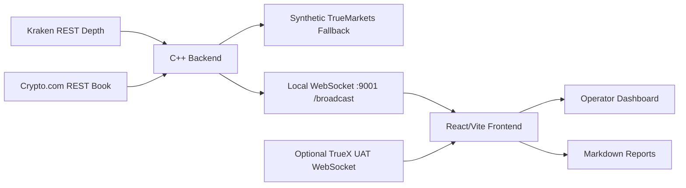

# LiquidityIntelligence

LiquidityIntelligence is a real-time liquidity and execution-quality intelligence dashboard for a True Markets style venue. It compares a TrueMarkets order book against a public benchmark venue, computes execution and liquidity risk metrics, and converts those metrics into actionable operator recommendations.

The project is best described as a route-confidence and liquidity-ops prototype. It is not a production matching engine and it should not be presented as a complete production smart order router. Its value is that it connects live market-data ingestion, deterministic analytics, execution simulation, and an institutional dashboard into one defensible demo.

## Table of Contents

- [Product Thesis](#product-thesis)
- [Current Truth: Live, Synthetic, and Derived Data](#current-truth-live-synthetic-and-derived-data)
- [Runtime Architecture](#runtime-architecture)
- [Repository Layout](#repository-layout)
- [Backend Architecture](#backend-architecture)
- [Frontend Architecture](#frontend-architecture)
- [External APIs and Data Sources](#external-apis-and-data-sources)
- [WebSocket Payload Contract](#websocket-payload-contract)
- [Metric Reference](#metric-reference)
- [Recommendation Engine](#recommendation-engine)
- [Execution Simulator](#execution-simulator)
- [Markdown Report Export](#markdown-report-export)
- [Dashboard Panels](#dashboard-panels)
- [Run Locally](#run-locally)
- [Build and Validation](#build-and-validation)
- [Sharing the Demo on a Local WiFi Network](#sharing-the-demo-on-a-local-wifi-network)
- [Deployment Notes](#deployment-notes)
- [Known Limitations](#known-limitations)
- [Interview Defense Notes](#interview-defense-notes)

## Product Thesis

LiquidityIntelligence answers a practical market-operations question:

> Is TrueMarkets currently competitive enough to receive flow, and if not, what specific condition should an operator inspect next?

The dashboard is built for a liquidity operations engineer, market-structure engineer, execution-quality reviewer, or product leader. It is not just a price display. It turns raw book differences into operational guidance.

Primary use cases:

1. Determine whether TrueMarkets is tighter, deeper, fresher, or cheaper than a benchmark venue.
2. Identify whether routing pressure is coming from spread, depth, quote lag, mid-price dislocation, or execution cost.
3. Simulate buy and sell execution scenarios before deciding whether to route, split, wait, or investigate.
4. Export one-hour or six-hour markdown reports for internal review.
5. Demonstrate a credible execution-quality product concept for a True Markets interview panel.

## Current Truth: Live, Synthetic, and Derived Data

This section is intentionally explicit because older project notes may mention stale venue names or outdated behavior.

| Data or behavior | Current status | Source of truth |
| --- | --- | --- |
| Benchmark order book | Live public data | C++ backend polls Kraken or Crypto.com REST depth endpoints |
| Backend TrueMarkets book | Synthetic fallback | Derived from the active benchmark book |
| Optional TrueMarkets feed | Live/UAT attempt | Frontend attempts `wss://uat.truex.co/api/v1` |
| TrueMarkets fallback behavior | Simulated | Benchmark-derived book with wider spread and scaled depth |
| Lag metric | Synthetic/heuristic | Triggered by benchmark mid-price movement in backend |
| Recommendations | Derived/rule-based | Frontend deterministic recommendation engine |
| Reports | Derived from observed frontend history | In-memory buffer, sampled while the app is running |
| Production matching engine | Not present | This repo does not implement order matching |

Important current-code facts:

- The backend supports benchmark selection between `Kraken` and `CryptoCom`.
- The primary displayed symbol is `BTC-PYUSD`.
- The backend broadcasts on local WebSocket port `9001`.
- The Vite frontend normally runs on port `5173`.
- The frontend WebSocket client currently connects to `ws://localhost:9001/broadcast`.
- The backend polls the benchmark roughly every 500 ms and broadcasts latest state roughly every 300 ms.
- The backend synthetic lag trigger is based on benchmark mid movement greater than about 2 bps, not the older documented 3 bps.
- The synthetic fallback reports lag during the lag window, but it is not a full production quote-reaction latency measurement.

## Runtime Architecture



High-level runtime flow:

1. `run_demo.sh` starts `backend/build/liquidity_console`.
2. The backend creates a uWebSockets server on port `9001`.
3. The backend starts a fetch thread that polls the selected benchmark venue.
4. The backend normalizes top-five order-book levels into a common snapshot shape.
5. The backend creates a synthetic TrueMarkets fallback book.
6. The backend broadcasts JSON snapshots over WebSocket topic `broadcast`.
7. The frontend connects to `ws://localhost:9001/broadcast`.
8. The frontend also attempts a direct TrueX UAT WebSocket connection.
9. The frontend chooses live TrueMarkets data if available; otherwise it uses the backend fallback.
10. The frontend computes dashboard metrics, recommendations, charts, report history, and panel state.

## Repository Layout

```text
LiquidityIntelligence/
  backend/
    CMakeLists.txt
    include/json.hpp
    src/main.cpp
    lib/uWebSockets/
  frontend/
    package.json
    vite.config.ts
    src/
      App.tsx
      components/
      hooks/
      utils/
      types/
  report/
    report.tex
    report.pdf
    interview_prep_report.tex
  run_demo.sh
  walkthrough.md
  README.md
```

Key files:

| File | Responsibility |
| --- | --- |
| `backend/src/main.cpp` | Entire C++ backend: REST fetch, parsing, metric helpers, synthetic fallback, WebSocket broadcast |
| `backend/CMakeLists.txt` | Native C++17 build, uSockets import, libcurl/ZLIB/thread linking |
| `frontend/src/App.tsx` | Main React orchestration: state, metric computation, layout, panels, reports |
| `frontend/src/hooks/useWebSocket.ts` | Local backend WebSocket client and subscription handling |
| `frontend/src/hooks/useTrueMarketsWS.ts` | Optional TrueX UAT WebSocket client and fallback detection |
| `frontend/src/hooks/useMarketHistoryBuffer.ts` | Six-hour in-memory report buffer sampled at most once per second |
| `frontend/src/hooks/useDashboardLayout.ts` | Collapsed/expanded widget state and Escape-to-restore handling |
| `frontend/src/utils/metrics.ts` | Shared frontend market metric helpers |
| `frontend/src/utils/executionAnalytics.ts` | Buy/sell VWAP, impact curve, fillable quantity, route recommendation logic |
| `frontend/src/utils/recommendations.ts` | Structured Action Center recommendation engine |
| `frontend/src/utils/reporting.ts` | Markdown report generation and browser download |
| `frontend/src/components/widgets/ActionCenter.tsx` | Sticky recommendation cards, manual refresh, five-card archive |
| `frontend/src/components/widgets/ExecutionSimulator.tsx` | Operator execution simulator and market impact chart |
| `frontend/src/components/dashboard/WidgetFrame.tsx` | Panel chrome, maximize/restore overlay, expanded workspace controls |

## Backend Architecture

The backend is a single native C++17 process built around:

- `libcurl` for REST API calls.
- `nlohmann::json` for JSON parsing and serialization.
- `uWebSockets` and `uSockets` for WebSocket broadcast.
- `std::thread` for the fetch loop and broadcast loop.
- `std::mutex` for protecting shared market-data state.

### Backend data structures

```cpp
struct Level {
    double price;
    double qty;
};

struct BookSnapshot {
    std::string venue;
    std::string symbol;
    uint64_t local_ts_ms;
    std::vector<Level> bids;
    std::vector<Level> asks;
};
```

The backend retains top-five bid and ask levels. Each venue parser maps exchange-specific JSON into this common shape.

### Backend threads

| Thread | Cadence | Responsibility |
| --- | ---: | --- |
| Fetch thread | roughly 500 ms sleep | Poll active benchmark REST depth endpoint, parse top-five book, update shared state |
| Broadcast thread | roughly 300 ms sleep | Serialize latest benchmark/fallback snapshots and publish over WebSocket |
| uWebSockets loop | event-driven | Accept browser clients, handle subscription messages, publish topic data |

### Benchmark parsing

The backend supports:

- Kraken response shape under `result.<pair>.bids` and `result.<pair>.asks`.
- Crypto.com response shape under `result.data[0].bids` and `result.data[0].asks`.

The backend parses price and size as doubles, keeps the first five levels, and computes mid, spread, and depth from the normalized result.

### Synthetic TrueMarkets fallback

When benchmark data is available, the backend creates `tm_fallback` from the benchmark book:

1. Copy active benchmark snapshot.
2. Rename venue to `TrueMarkets`.
3. Add about `+0.5 bps` to the top-of-book spread.
4. Recenter the top bid and top ask around the benchmark mid.
5. Scale bid and ask quantities by `0.8`.
6. During synthetic lag windows, report `current_lag_ms`.

This fallback exists so the demo remains usable even when the optional TrueX UAT WebSocket is unavailable.

## Frontend Architecture

The frontend is a React/Vite application with Tailwind styling and Recharts visualizations.

Core frontend responsibilities:

- Connect to local backend WebSocket.
- Attempt direct TrueX UAT WebSocket connection.
- Choose displayed TrueMarkets source.
- Compute user-facing metrics.
- Run side-aware execution simulation.
- Generate structured recommendations.
- Maintain sticky recommendation snapshots.
- Maintain report history buffer.
- Render high-density trading-style panels.
- Support panel collapse, maximize, restore, and Escape-to-restore.

### Source selection

The frontend uses this source order:

1. If TrueX UAT WebSocket has a live snapshot and is not in fallback mode, use that snapshot.
2. Otherwise, use the backend synthetic `truemarkets` snapshot.

Benchmark data always comes from the backend public benchmark feed.

### Dashboard state

`App.tsx` owns:

- selected asset;
- selected benchmark;
- latest backend payload;
- optional TrueMarkets live snapshot;
- chart history;
- metric sparkline history;
- execution side and size;
- recommendation snapshots and archive;
- report history buffer;
- dashboard layout state.

## External APIs and Data Sources

| Source | Transport | Endpoint or subscription | Used for |
| --- | --- | --- | --- |
| Kraken | REST polling | `https://api.kraken.com/0/public/Depth?pair=BTCPYUSD&count=5` | Public benchmark top-five book |
| Crypto.com | REST polling | `https://api.crypto.com/exchange/v1/public/get-book?instrument_name=BTC_PYUSD&depth=5` | Alternate public benchmark top-five book |
| TrueX UAT | Browser WebSocket | `wss://uat.truex.co/api/v1` | Optional TrueMarkets DEPTH/EBBO source |
| Local backend | Browser WebSocket | `ws://localhost:9001/broadcast` | Main stream to React dashboard |

TrueX subscription message:

```json
{
  "type": "SUBSCRIBE_NO_AUTH",
  "item_names": ["BTC-PYUSD"],
  "channels": ["DEPTH", "EBBO"],
  "timestamp": "..."
}
```

Backend subscription message:

```json
{
  "action": "subscribe",
  "asset": "BTC",
  "benchmark": "Kraken"
}
```

## WebSocket Payload Contract

The backend broadcasts a JSON payload with this effective shape:

```json
{
  "timestamp": 1710000000000,
  "benchmark": {
    "venue": "Kraken",
    "mid": 65000.0,
    "spread_bps": 0.25,
    "bid_depth_5": 1.23,
    "ask_depth_5": 1.10,
    "bids": [[64999.0, 0.4]],
    "asks": [[65001.0, 0.3]]
  },
  "truemarkets": {
    "venue": "TrueMarkets",
    "mid": 65000.0,
    "spread_bps": 0.75,
    "bid_depth_5": 0.98,
    "ask_depth_5": 0.88,
    "bids": [[64997.0, 0.32]],
    "asks": [[65003.0, 0.24]]
  },
  "insights": {
    "status": "Competitive",
    "reason": "Liquidity tracking benchmark within tolerance.",
    "color": "green"
  },
  "lag_ms": 0,
  "dashboard_meta": {
    "feedMode": "Live",
    "isStale": false,
    "staleMs": 0,
    "benchmarkName": "Kraken",
    "asset": "BTC"
  },
  "metric_snapshots": []
}
```

The frontend normalizes legacy `payload.binance` into `payload.benchmark` if needed, but the current backend emits `benchmark`.

## Metric Reference

### Mid price

```text
mid = (best_bid + best_ask) / 2
```

Used as the reference point for spread and mid-price deviation.

### Spread in basis points

```text
spread_bps = ((best_ask - best_bid) / mid) * 10000
```

Measures top-of-book tightness.

### Spread delta

```text
spread_delta_bps = truemarkets_spread_bps - benchmark_spread_bps
```

Interpretation:

- Positive: TrueMarkets is wider than the benchmark.
- Negative: TrueMarkets is tighter than the benchmark.
- Near zero: top-of-book spread is broadly aligned.

### Mid-price deviation

```text
mid_deviation_bps = ((truemarkets_mid - benchmark_mid) / benchmark_mid) * 10000
```

Used to detect benchmark-relative price dislocation.

### Top-five depth

```text
bid_depth_5 = sum(top_5_bid_quantities)
ask_depth_5 = sum(top_5_ask_quantities)
```

### Depth ratio

```text
depth_ratio = (tm_bid_depth_5 + tm_ask_depth_5) /
              (benchmark_bid_depth_5 + benchmark_ask_depth_5)
```

Interpretation:

- `> 1.0`: TrueMarkets has more displayed top-five depth.
- `~ 1.0`: displayed depth is comparable.
- `< 1.0`: TrueMarkets is thinner.

### VWAP

For a target size, walk book levels until the target is filled:

```text
vwap = sum(fill_qty_i * price_i) / sum(fill_qty_i)
```

For buys, the simulator walks asks. For sells, it walks bids.

### Slippage advantage

The dashboard-level slippage proxy uses benchmark best-ask quantity as the representative buy size:

```text
slippage_advantage_bps =
  ((benchmark_ask_vwap - truemarkets_ask_vwap) / benchmark_ask_vwap) * 10000
```

Interpretation:

- Positive: TrueMarkets is cheaper for the representative market buy.
- Negative: benchmark is cheaper.
- Zero: roughly cost-neutral.

### Side-aware execution edge

The execution simulator is symmetric across buy and sell:

```text
buy_edge_bps =
  ((benchmark_ask_vwap - truemarkets_ask_vwap) / benchmark_ask_vwap) * 10000

sell_edge_bps =
  ((truemarkets_bid_vwap - benchmark_bid_vwap) / benchmark_bid_vwap) * 10000
```

Positive edge means TrueMarkets is better for the selected side and size.

### Market impact

For buys:

```text
impact_bps = ((vwap - best_ask) / best_ask) * 10000
```

For sells:

```text
impact_bps = ((best_bid - vwap) / best_bid) * 10000
```

### Fillable quantity within X bps

For a selected threshold, the simulator sums visible quantity within that price distance from best:

```text
buy_distance_bps = ((level_ask_price - best_ask) / best_ask) * 10000
sell_distance_bps = ((best_bid - level_bid_price) / best_bid) * 10000
```

Levels with distance less than or equal to the selected threshold are counted.

### Routing risk score

Composite score from 0 to 100:

```text
risk =
  spread_penalty +
  slippage_penalty +
  depth_penalty +
  lag_penalty
```

Current weighting:

```text
spread_penalty   = min(30, max(0, spread_gap * 15))
slippage_penalty = min(30, max(0, -slippage_advantage * 10))
depth_penalty    = min(20, max(0, (1 - depth_ratio) * 40))
lag_penalty      = min(20, max(0, lag_ms / 10))
```

### Quote freshness

```text
quote_freshness_score = clamp(100 - lag_ms / 2.4 - feed_penalty, 0, 100)
```

Feed penalties:

- `Fallback Mock`: 18 points.
- `Connecting...`: 45 points.
- live modes: 0 points.

Labels:

- `Fresh`: score >= 75.
- `Watch`: score >= 45 and < 75.
- `Stale`: score < 45.

### Liquidity Provider Health

LP health combines spread competitiveness, displayed depth, executable edge, and quote freshness:

```text
lp_health =
  0.28 * spread_score +
  0.26 * depth_score +
  0.24 * edge_score +
  0.22 * freshness_score
```

Labels:

- `Strong`: score >= 75.
- `Watch`: score >= 50 and < 75.
- `Weak`: score < 50.

## Recommendation Engine

The Action Center uses `frontend/src/utils/recommendations.ts`. It is deterministic and rule-based. It does not call an LLM and does not generate ungrounded prose.

Each recommendation includes:

- `id`
- `title`
- `severity`: `info`, `warning`, or `critical`
- `urgency`: `Immediate action`, `Monitor`, or `Investigate later`
- `operationalImpact`
- `recommendedActions`
- `evidence`
- `rankScore`

Rules currently cover:

| Rule | Trigger concept | Operator meaning |
| --- | --- | --- |
| `spread-uncompetitive` | TrueMarkets spread wider than benchmark | Aggressive flow may route away |
| `top-depth-thin` | Top-five depth ratio below threshold | Larger orders may walk the book faster |
| `quote-lag` | Lag or freshness degradation | Displayed quote may be stale |
| `execution-cost-disadvantage` | Selected scenario favors benchmark | Current order may be cheaper away |
| `elevated-flow-risk` | Composite routing risk elevated | Multiple conditions suggest route caution |
| `mid-dislocation` | Mid-price deviation large | Possible feed skew or stale reference pricing |
| `unstable-regime` | Recent samples stressed | Problem may be persistent, not a single tick |
| `healthy-monitoring` | No major issue | Continue monitoring |

The UI shows at most the top three recommendations. The cards are sticky: they do not vanish on every tick. They refresh manually or automatically after at most five minutes. Up to five previous card snapshots are available in the archive dropdown.

## Execution Simulator

The execution simulator is in `frontend/src/components/widgets/ExecutionSimulator.tsx` and `frontend/src/utils/executionAnalytics.ts`.

It supports:

- Buy/sell side selection.
- Size presets.
- Fillable quantity within selected bps threshold.
- TrueMarkets VWAP.
- Benchmark VWAP.
- Net execution edge.
- Expected market impact curve.
- Route recommendation:
  - route to TrueMarkets;
  - route to benchmark;
  - split order;
  - wait / do not route.

The simulator is intentionally a visible-book model. It does not include hidden liquidity, fee tiers, reject probability, queue position, or adverse-selection modeling.

## Markdown Report Export

Reports are generated in the frontend by `frontend/src/utils/reporting.ts`.

Supported windows:

- Last 1 hour.
- Last 6 hours.

History source:

- `useMarketHistoryBuffer.ts`.
- In-memory only.
- Samples at most once per second.
- Retains up to six hours.
- Resets on page refresh or asset/benchmark switch.

Report sections include:

- title;
- generated timestamp;
- selected pair;
- benchmark;
- requested and available window;
- headline verdict;
- executive summary;
- key metric summary;
- spread analysis;
- mid deviation analysis;
- lag/freshness analysis;
- depth/liquidity analysis;
- event summary;
- recommended next actions;
- raw latest snapshot summary;
- disclaimer.

The report explicitly handles partial windows. If the dashboard has only observed 15 minutes, a one-hour export says only 15 minutes are available.

## Dashboard Panels

| Panel | Purpose |
| --- | --- |
| Header | Asset, benchmark, feed mode, layout controls |
| Decision Band | Headline state: status, spread gap, mid deviation, lag, top recommendation |
| Action Center | Top three sticky recommendations and evidence |
| Execution Simulator | Side-aware execution model and route recommendation |
| Quote Freshness / LP Health | Feed confidence and liquidity provider health |
| KPI Cards | Slippage, spread delta, latency, routing risk |
| Spread Alignment Chart | Time-series spread delta with parity baseline |
| Slippage Trajectory Chart | Time-series slippage advantage with parity baseline |
| Liquidity Profile Table | Side-by-side venue metric comparison |
| Order Books | TrueMarkets and benchmark top levels |
| Markdown Reports | One-hour and six-hour report download |

Panels that support maximize show a maximize control in normal mode and a restore control in expanded mode. Escape restores an expanded panel.

## Run Locally

### Prerequisites

- macOS or Linux shell.
- CMake 3.14 or newer.
- C++17 compiler.
- `make`.
- `zlib`.
- `libcurl`.
- Node 22 for the frontend.

The known working frontend path uses:

```bash
npx -p node@22 -- npm run build
```

### Backend build

From the backend directory:

```bash
cd LiquidityIntelligence/backend

# Build uSockets archive if needed.
cd lib/uWebSockets/uSockets
make

# Build backend.
cd ../../../
cmake -S . -B build
cmake --build build
```

Expected backend binary:

```text
LiquidityIntelligence/backend/build/liquidity_console
```

### Full demo

From the LiquidityIntelligence directory:

```bash
cd LiquidityIntelligence
./run_demo.sh
```

Open:

```text
http://localhost:5173
```

The script starts:

1. C++ backend from `backend/build/liquidity_console`.
2. Vite frontend from `frontend/`.

### Manual startup

Terminal 1:

```bash
cd LiquidityIntelligence/backend/build
./liquidity_console
```

Terminal 2:

```bash
cd LiquidityIntelligence/frontend
npx -p node@22 -- npm run dev
```

## Build and Validation

Frontend validation:

```bash
cd LiquidityIntelligence/frontend
npx -p node@22 -- npm run build
npx -p node@22 -- npm run lint
```

Backend validation:

```bash
cd LiquidityIntelligence/backend
cmake --build build
```

Runtime checks:

1. Backend logs `[WS] Listening on port 9001`.
2. Frontend loads on `http://localhost:5173`.
3. Header shows connected feed state.
4. Order books populate.
5. Spread and slippage charts collect history.
6. Action Center shows recommendation cards.
7. Export 1h and 6h markdown buttons download valid markdown.
8. Maximized panels restore via button, backdrop, and Escape.

## Sharing the Demo on a Local WiFi Network

This app can be shared on an office WiFi network if the network allows device-to-device traffic.

Conceptually:

1. Run backend on your laptop at port `9001`.
2. Run frontend on your laptop at port `5173` bound to `0.0.0.0`.
3. Give panelists your LAN URL, for example:

```text
http://10.24.18.73:5173
```

Important caveat:

The current frontend backend URL is hardcoded to `ws://localhost:9001/broadcast`. For LAN sharing, that must be changed to resolve the backend host dynamically, for example:

```ts
const backendWsUrl =
  import.meta.env.VITE_BACKEND_WS_URL ??
  `ws://${window.location.hostname}:9001/broadcast`;
```

Without that change, panelists' browsers will try to connect to their own `localhost:9001`, not your laptop.

Also note that many office WiFi networks enable client isolation. If client isolation is enabled, other laptops cannot reach your laptop even if everyone is on the same WiFi.

## Deployment Notes

For a public demo URL, deploy this as two services:

1. Backend WebSocket service.
2. Frontend static Vite site.

The frontend should use an environment variable such as:

```text
VITE_BACKEND_WS_URL=wss://your-backend-host.example.com/broadcast
```

The backend should be adjusted to listen on the platform-provided port instead of hardcoded `9001`:

```cpp
const char* port_env = std::getenv("PORT");
int port = port_env ? std::stoi(port_env) : 9001;
```

Then call `.listen(port, ...)`.

For cloud deployment, rebuild `uSockets.a` inside the target Linux environment. Do not rely on a macOS-built static archive.

## Known Limitations

This section is part of the project's credibility. These are known limitations, not hidden defects.

1. The backend TrueMarkets book is synthetic unless the optional TrueX UAT frontend feed is connected.
2. The backend uses REST polling for benchmark venues, not exchange-native WebSocket depth streams.
3. The lag metric is heuristic and synthetic, not measured production reaction latency.
4. Only top-five levels are retained.
5. Fees, rebates, hidden liquidity, queue position, reject rates, and fill probability are not modeled.
6. Report history is in-memory and resets on refresh.
7. Backend metric snapshots may be based on backend fallback even when the frontend is displaying optional TrueX UAT data.
8. Current symbol support is focused on `BTC-PYUSD`.
9. Production auth, persistence, alert delivery, deployment hardening, and observability are out of scope for the prototype.

## Interview Defense Notes

Strong concise framing:

> LiquidityIntelligence is a route-confidence layer. It combines benchmark market data, a TrueMarkets live-or-fallback book, deterministic execution analytics, and an Action Center that tells an operator what to inspect next.

What to be direct about:

- The benchmark feed is live public data.
- The backend TrueMarkets book is synthetic fallback data.
- The optional TrueX UAT connection is attempted from the browser.
- The project demonstrates architecture, product thinking, and execution-quality reasoning.
- It does not claim production execution quality without production TrueMarkets data.

Expected panel questions:

### Why does this matter?

Execution quality is not just whether a venue is up. Operators need to know whether a venue is tight, deep, fresh, and executable for the current order scenario. This dashboard turns those conditions into route confidence and next actions.

### Why C++?

C++ is a reasonable backend choice for market-data and low-latency systems because it gives explicit control over memory, threading, and networking. In this prototype the C++ service is intentionally small: fetch, normalize, compute lightweight metrics, and broadcast.

### Why WebSockets?

The UI is streaming and stateful. WebSockets let the backend push the latest book and metrics to the browser without repeated HTTP polling from the frontend.

### Why are recommendations deterministic?

For liquidity operations, explainability matters. A deterministic rule can cite spread delta, depth ratio, quote freshness, and execution edge. That is easier to defend than opaque generated text.

### What would you improve over the summer?

1. Replace public REST polling with streaming depth feeds.
2. Connect canonical production TrueMarkets data.
3. Persist history in a time-series store.
4. Measure real reaction latency with synchronized timestamps.
5. Calibrate recommendation thresholds against realized fills.
6. Add multi-symbol and multi-venue coverage.
7. Add production alerting and incident review workflows.

## License and Attribution

This repository includes vendored `uWebSockets`/`uSockets` sources under `backend/lib/uWebSockets/`. See the vendored library files for their upstream license terms.
